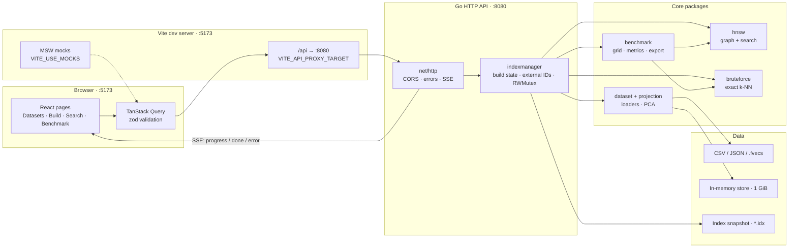
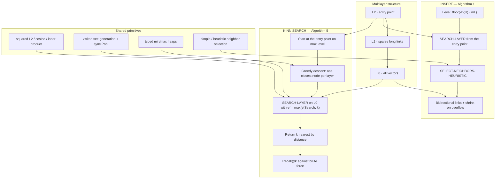
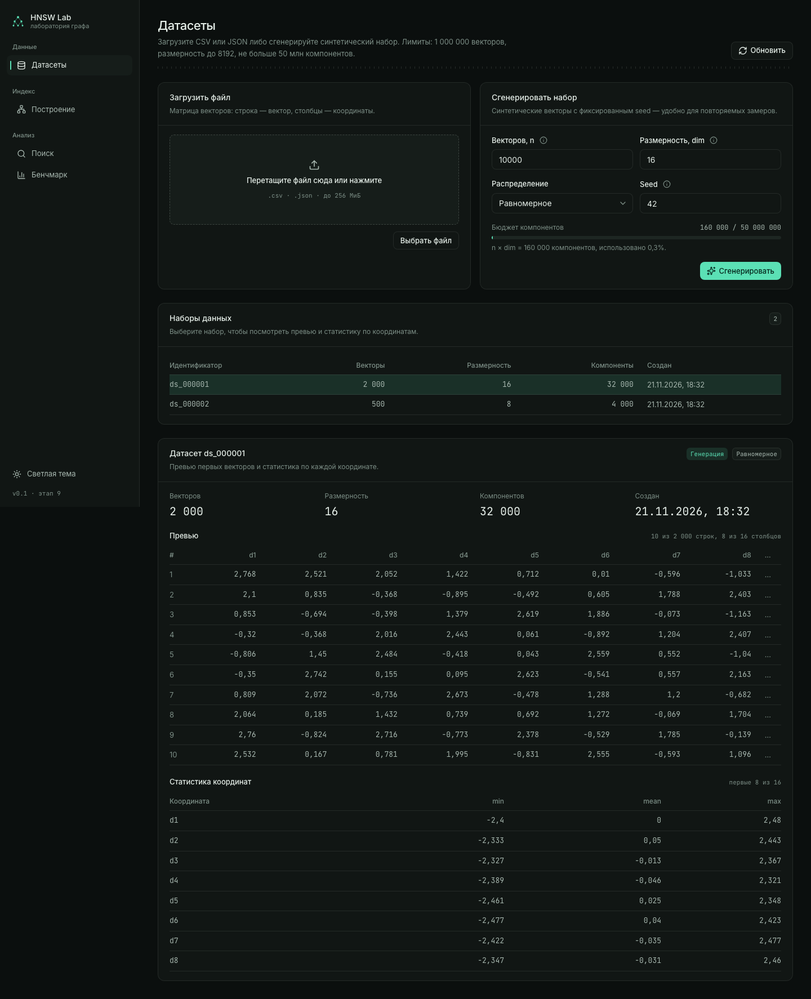
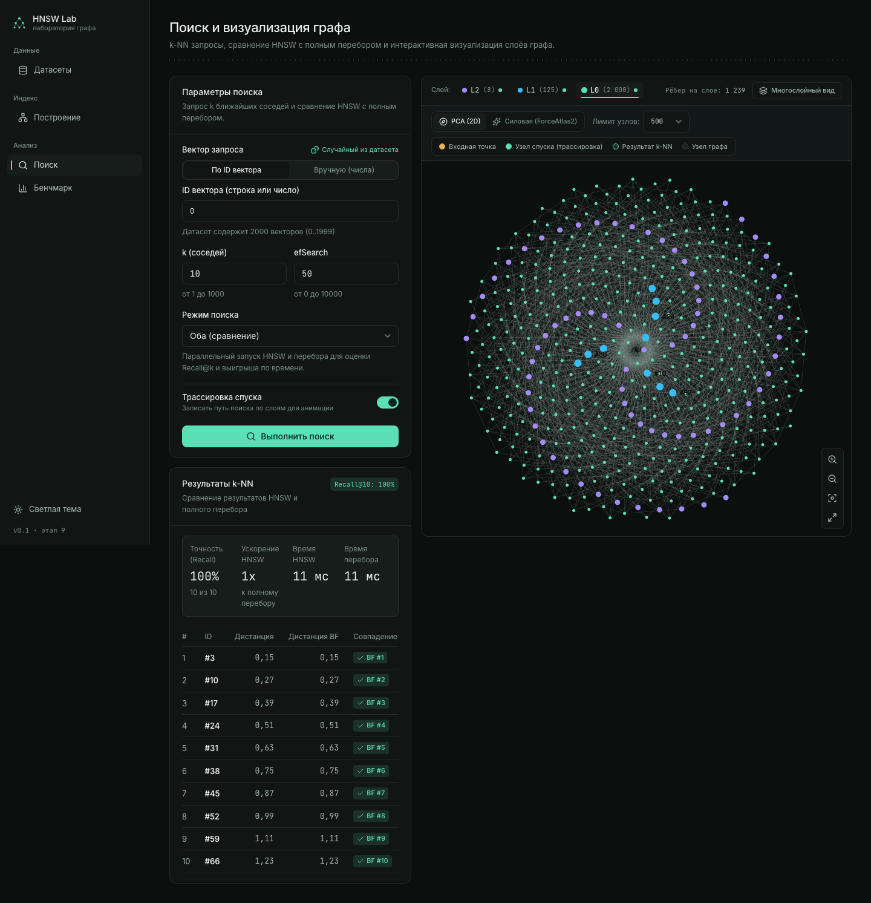

# HNSW Coursework


**English** · [Русский](README_RU.md)

Design of the HNSW data structure and its use for approximate nearest neighbor search.

## Status

All planned stages are complete: HNSW core, dataset loaders and generators, brute-force reference and
quality metrics, benchmark module, HTTP API, CLI-verified backend hardening, and the React UI
(datasets, index build, search, graph visualization, benchmark). Stage 9 covers the end-to-end
scenario, edge cases, graph performance, Docker Compose and documentation.

## Architecture

### Service



### HNSW algorithm



## Stack

- **Backend:** Go 1.22+, module `hnsw-coursework`, HNSW from scratch (no third-party ANN libraries), stdlib `net/http`.
- **Frontend:** React 19 + TypeScript (Vite 8), Tailwind CSS 4, TanStack Query 5, React Router 7, zod, MSW, Vitest, Sigma.js v3 + Graphology.
- **Vectors:** `[]float32`; internal IDs: `uint32`; squared L2 internally (`sqrt` only in API output).

## Repository layout

```
README_RU.md       Russian version of this document
backend/            Go backend: cmd/server, internal/{hnsw,bruteforce,dataset,projection,benchmark,api,indexmanager}
frontend/           React + TypeScript (Vite) UI
docs/               PLAN.md, API.md, screenshots/
scripts/            dataset download scripts (datasets are not committed)
.github/workflows/  GitHub Actions CI
docker-compose.yml  local backend + frontend in containers
```

## Run

Backend (listens on `:8080`, override with `PORT`):

```bash
cd backend
make run        # go run ./cmd/server
```

Frontend (listens on `:5173`, proxies `/api` to `http://localhost:8080`):

```bash
cd frontend
npm install
npm run dev          # with a real backend
npm run dev:mocks    # with MSW mocks, no backend needed
npm run build        # type-check + production build
```

From the repository root the backend targets also work as `make -C backend <target>`.

Docker Compose (both services, frontend on :5173, backend on :8080):

```bash
docker-compose up --build
docker-compose down
```

In containers the Vite proxy target comes from `VITE_API_PROXY_TARGET` (default
`http://localhost:8080`); Compose sets it to `http://backend:8080`.

## Workflow

1. **Datasets** (`/datasets`) — upload `.csv`/`.json` via drag-and-drop or generate a synthetic set
   (uniform, gaussian, clusters) with a fixed seed; inspect preview and coordinate statistics.

   

2. **Build** (`/index`) — choose a dataset, `M`, `efConstruction`, metric, neighbor-selection heuristic
   and seed. Build progress arrives over SSE; the finished screen shows node counts per level and the
   degree histogram.

   

3. **Search** (`/search`) — query by vector ID or by explicit coordinates, choose `k`, `efSearch` and
   HNSW / brute force / both. The results table reports Recall@k, overlap and speedup; the WebGL graph
   supports layer switching, PCA or ForceAtlas2 layout, node inspection, neighborhood mode and a
   step-by-step trace of the layer descent.

   

4. **Benchmark** (`/benchmark`) — run an `M × efConstruction × efSearch` grid and inspect recall,
   Pareto QPS, latency percentiles, build time and the results table; charts export to PNG and the
   table to CSV.

   

## Verification

```bash
cd backend && gofmt -l . && go vet ./... && go test ./... && go test -race ./...
cd frontend && npm run format:check && npm run lint && npm run test && npm run build
```

The full UI scenario was also exercised end-to-end in Chromium against the real backend:
generate dataset → build index → search (including `k > N` and rebuild) → graph → benchmark.
The graph was checked at 2000 nodes / ~17k edges with no console errors.

API contract: `docs/API.md`. Plan and progress: `docs/PLAN.md`.

## Notes

- Large datasets (SIFT etc.) are never committed; download via `scripts/download_sift.sh`. HTTP upload accepts
  `.csv` and `.json` only; `.fvecs`/`.ivecs` are read by the Go loaders and benchmarks.
- CORS is enabled for `http://localhost:5173`; the Vite dev server also proxies `/api` so the UI does not depend on CORS.
- The in-memory dataset store has a 1 GiB budget; exceeding it returns `507 STORE_FULL`.
