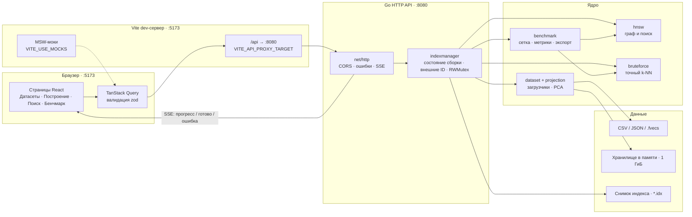
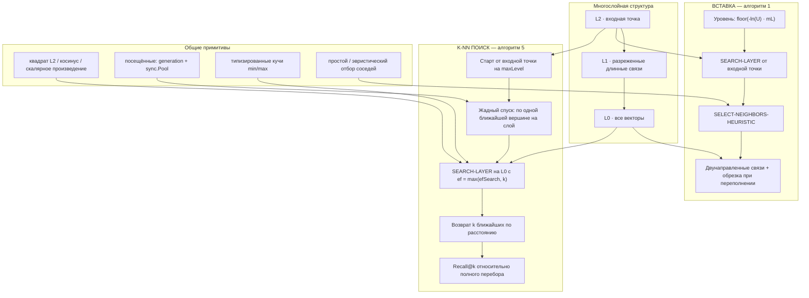
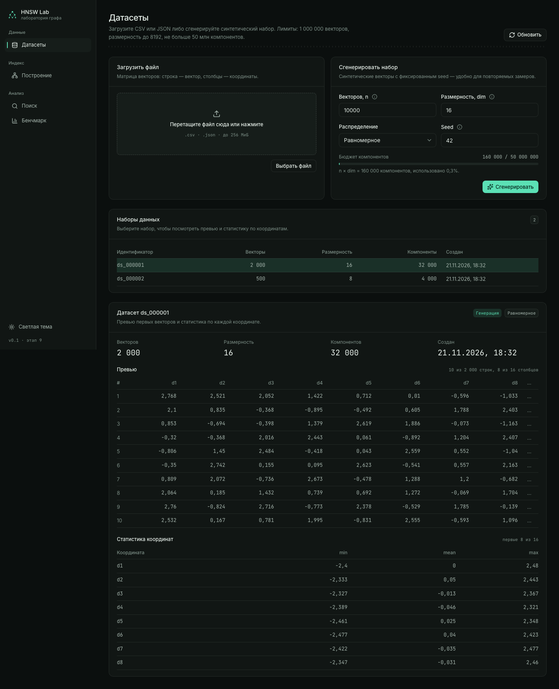
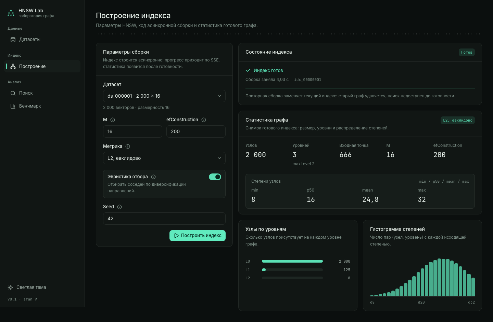
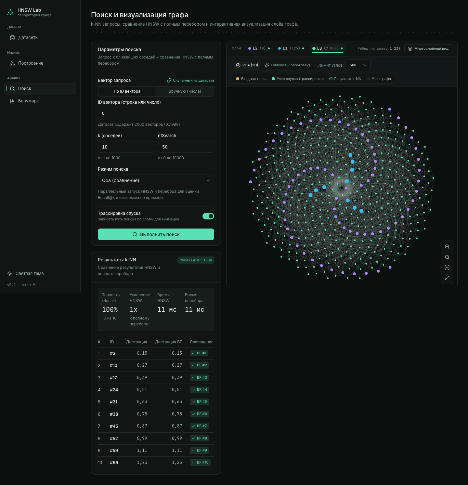
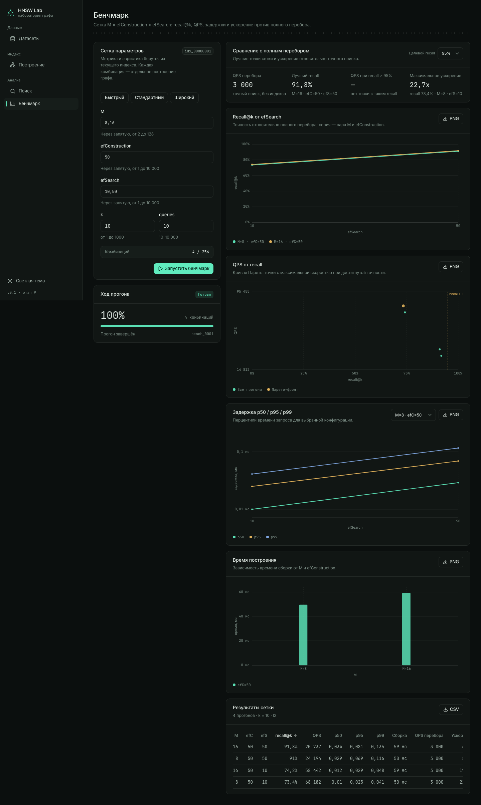

# HNSW Coursework


[English](README.md) · **Русский**

Проектирование структуры данных HNSW и её применение для приближённого поиска ближайших соседей.

## Статус

Все запланированные этапы завершены: ядро HNSW, загрузчики и генераторы датасетов, точный поиск
и метрики качества, модуль бенчмарка, HTTP API, укрепление бэкенда и React-интерфейс (датасеты,
построение индекса, поиск, визуализация графа, бенчмарк). Этап 9 охватывает сквозной сценарий,
граничные случаи, производительность графа, Docker Compose и документацию.

## Архитектура

### Сервис



### Алгоритм HNSW



## Стек

- **Бэкенд:** Go 1.22+, модуль `hnsw-coursework`, HNSW с нуля (без сторонних ANN-библиотек), стандартный `net/http`.
- **Фронтенд:** React 19 + TypeScript (Vite 8), Tailwind CSS 4, TanStack Query 5, React Router 7, zod, MSW, Vitest, Sigma.js v3 + Graphology.
- **Векторы:** `[]float32`; внутренние ID: `uint32`; внутри используется квадрат L2 (`sqrt` только на выходе API).

## Структура репозитория

```
README_RU.md       Русская версия этого документа
backend/            Go-бэкенд: cmd/server, internal/{hnsw,bruteforce,dataset,projection,benchmark,api,indexmanager}
frontend/           React + TypeScript (Vite) интерфейс
docs/               PLAN.md, API.md, screenshots/
scripts/            скрипты загрузки датасетов (сами датасеты не коммитятся)
.github/workflows/  GitHub Actions CI
docker-compose.yml  локальный запуск бэкенда и фронтенда в контейнерах
```

## Запуск

Бэкенд (слушает `:8080`, порт можно изменить через `PORT`):

```bash
cd backend
make run        # go run ./cmd/server
```

Фронтенд (слушает `:5173`, проксирует `/api` на `http://localhost:8080`):

```bash
cd frontend
npm install
npm run dev          # с реальным бэкендом
npm run dev:mocks    # с MSW-моками, без бэкенда
npm run build        # проверка типов + production-сборка
```

Из корня репозитория цели бэкенда доступны как `make -C backend <цель>`.

Docker Compose (оба сервиса, фронтенд на :5173, бэкенд на :8080):

```bash
docker-compose up --build
docker-compose down
```

В контейнерах адрес прокси Vite берётся из `VITE_API_PROXY_TARGET` (по умолчанию
`http://localhost:8080`); Compose задаёт `http://backend:8080`.

## Сценарий работы

1. **Датасеты** (`/datasets`) — загрузка `.csv`/`.json` через drag-and-drop или генерация
   синтетического набора (uniform, gaussian, clusters) с фиксированным seed; превью и статистика
   координат.

   

2. **Построение** (`/index`) — выбор датасета, `M`, `efConstruction`, метрики, эвристики отбора
   соседей и seed. Прогресс приходит по SSE; после готовности показываются число вершин по уровням
   и гистограмма степеней.

   

3. **Поиск** (`/search`) — запрос по ID вектора или по координатам, настройка `k`, `efSearch` и режим
   HNSW / полный перебор / оба. Таблица результатов показывает Recall@k, пересечение и ускорение;
   WebGL-граф поддерживает переключение слоёв, укладки PCA и ForceAtlas2, просмотр вершины, режим
   окрестности и пошаговую анимацию спуска.

   

4. **Бенчмарк** (`/benchmark`) — прогон сетки `M × efConstruction × efSearch` и графики recall,
   Парето по QPS, перцентилей задержки, времени построения и таблица результатов; графики
   экспортируются в PNG, таблица — в CSV.

   

## Проверка

```bash
cd backend && gofmt -l . && go vet ./... && go test ./... && go test -race ./...
cd frontend && npm run format:check && npm run lint && npm run test && npm run build
```

Полный сценарий также прогонялся в Chromium с реальным бэкендом: загрузка CSV и генерация →
сборка индекса → поиск (включая `k > N` и rebuild) → граф → бенчмарк. Граф проверен на 2000 вершин
и ~17 тыс. рёбер без ошибок в консоли.

Контракт API: `docs/API.md`. План и прогресс: `docs/PLAN.md`.

## Примечания

- Большие датасеты (SIFT и др.) никогда не коммитятся; скачивайте их через `scripts/download_sift.sh`.
  По HTTP принимаются только `.csv` и `.json`; `.fvecs`/`.ivecs` читаются загрузчиками Go и бенчмарками.
- CORS включён для `http://localhost:5173`; Vite-сервер также проксирует `/api`, поэтому интерфейс
  не зависит от CORS.
- Хранилище датасетов в памяти ограничено 1 ГиБ; при превышении возвращается `507 STORE_FULL`.
